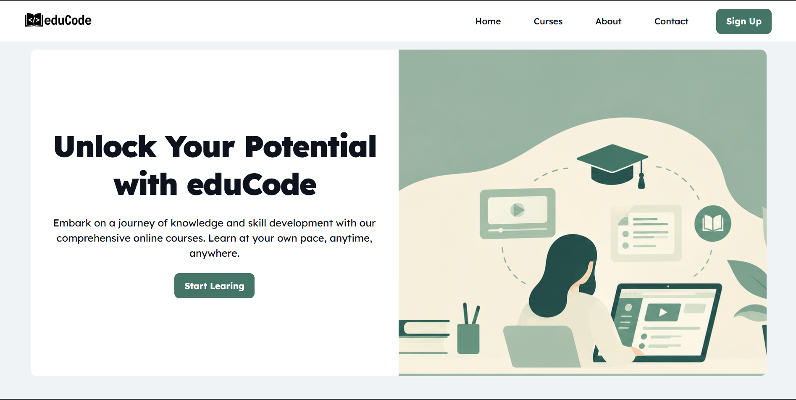
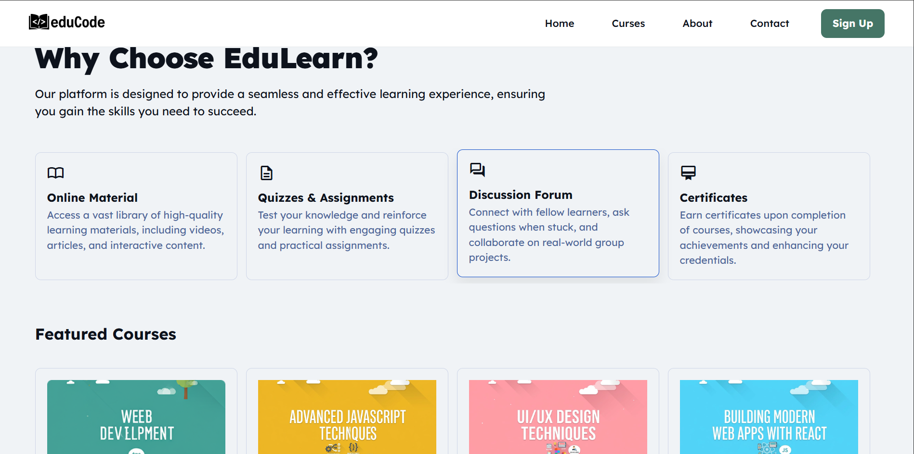
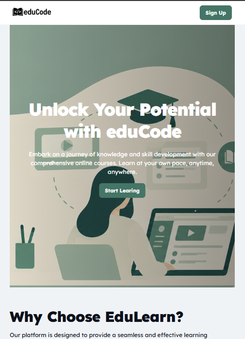
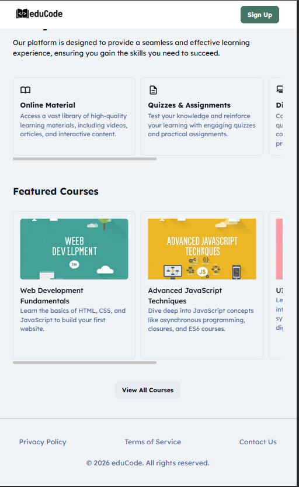
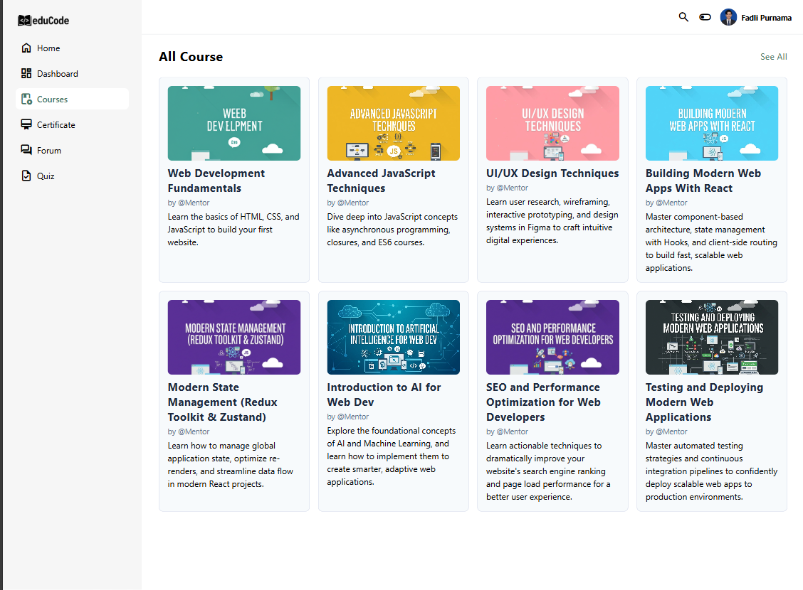
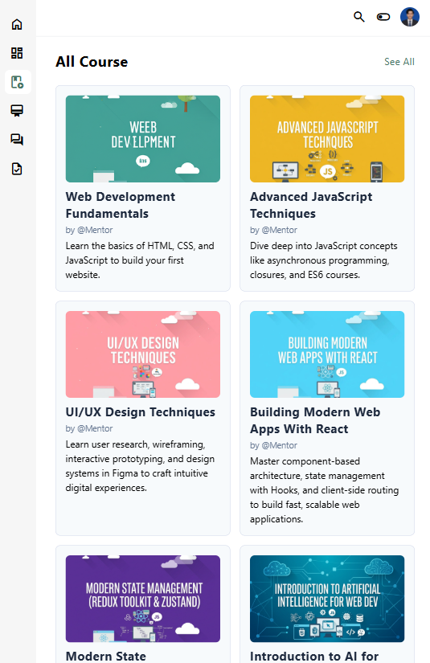

# eduCode — Mini Project Full-Stack Web Development


---

## Deskripsi Proyek

**eduCode** adalah proyek Mini Project Full-Stack Web Development dalam program bootcamp yang membangun antarmuka **Learning Management System (LMS)** berbasis web. Proyek ini terdiri dari dua halaman utama yang dikerjakan dengan pendekatan teknologi berbeda:

- **Halaman Pertama (Landing Page)** — dibangun menggunakan **HTML5 semantik & Vanilla CSS** murni, mencakup navigasi, hero section, benefit section, dan daftar kursus unggulan.
- **Halaman Kedua (Dashboard Kursus)** — dibangun menggunakan **Tailwind CSS v4**, menampilkan layout dashboard dengan sidebar navigasi kolapsibel, header profil pengguna, dan grid katalog kursus yang responsif.

Keduanya dirancang dengan prinsip **responsif**, aksesibel, dan modular — mengikuti standar pengembangan antarmuka web modern.

---

## Tech Stack / Teknologi yang Digunakan

| Teknologi | Keterangan |
|---|---|
| **HTML5 Semantik** | Struktur dokumen dengan elemen `<header>`, `<main>`, `<section>`, `<aside>`, `<footer>`, `<nav>` |
| **Vanilla CSS3** | Styling manual dengan CSS Variables, Flexbox, Grid, dan Media Queries pada `style.css` |
| **Tailwind CSS v4** | Utility-first CSS framework via CDN (`@tailwindcss/browser@4`), dengan kustomisasi `@theme` dan `@layer components` |
| **Google Fonts** | Tipografi menggunakan font **Lexend** dan **Open Sans** |
| **Material Symbols Outlined** | Icon set dari Google untuk elemen navigasi dan kartu fitur |

---

## Struktur Proyek

```
ASSIGNMENT Day 6 - Mini Project Full-Stack : HTML CSS & Tailwind/
│
├── index.html                  # Halaman 1: Landing Page (HTML & Vanilla CSS)
├── courses-tailwindcss.html    # Halaman 2: Dashboard Kursus (Tailwind CSS)
├── style.css                   # File stylesheet utama untuk Landing Page
│
└── assets/
   └── images/
       ├── logo.png            # Logo eduCode
       ├── hero.png            # Gambar hero section
       ├── user-image.png      # Avatar profil pengguna
       └── courses/            # Thumbnail gambar kursus
```

---

## Fitur Utama & Implementasi

### Halaman 1 — Landing Page (`index.html` + `style.css`)

#### Responsivitas
- Layout menyesuaikan tampilan di tiga breakpoint menggunakan **CSS Media Queries**:
  - **Mobile** (default): hero single-column, navbar menyembunyikan menu navigasi
  - **Tablet** (`≥768px`): menu navigasi mulai ditampilkan
  - **Desktop** (`≥1024px`): hero beralih ke dua kolom (`grid-template-columns: 1fr 1fr`), teks hero muncul di sisi kiri dengan latar putih, gambar hero berada di sisi kanan

#### Layout — Flexbox & Grid
- **Navbar**: Flexbox horizontal (`justify-content: space-between`) untuk logo dan menu
- **Hero Section**: CSS Grid dengan kolom adaptif (1-kolom di mobile, 2-kolom di desktop)
- **Benefit & Course Cards**: Horizontal scrollable Flexbox (`scroll-snap-type: x mandatory`) dengan kartu tetap lebar (`flex-shrink: 0`)
- **Footer**: Flexbox vertikal dengan navigasi link dan copyright terpusat

#### Hover & Focus State
- Tombol `.btn-primary` dan `.btn-secondary`: transisi warna latar, efek `transform: scale(0.92)`, dan `box-shadow` saat di-hover
- Kartu kursus `.card-item`: efek `translateY(-4px)`, shadow, dan perubahan warna border saat di-hover
- Item navigasi navbar: perubahan warna teks dan latar saat `:hover` dan `:focus`

#### CSS Variables
- Sistem desain konsisten menggunakan **custom properties** di `:root` untuk warna background, teks, tombol, border, dan header

#### Aksesibilitas Dasar
- `<h1 class="sr-only">` — heading tersembunyi untuk screen reader, judul halaman tetap terbaca oleh teknologi asistif
- Atribut `alt` pada seluruh elemen `` (logo, hero, thumbnail kursus)
- Hierarki heading runtut: `H1` (sr-only) → `H2` (section title) → `H3` (card title)
- Tag semantik: `<header>`, `<main>`, `<section>`, `<footer>`, `<nav>`, `<ul>/<li>` untuk navigasi

---

### Halaman 2 — Dashboard Kursus (`courses-tailwindcss.html`)

#### Responsivitas
- Layout dashboard responsif menggunakan **CSS Grid** Tailwind:
  - **Mobile**: sidebar sempit `60px` (ikon saja), konten utama mengambil sisa ruang
  - **Tablet** (`md:`): sidebar melebar `80px`
  - **Desktop** (`lg:`): sidebar penuh `260px` menampilkan label teks di samping ikon
- Grid katalog kursus menyesuaikan jumlah kolom: `1 → 2 → 3 → 4` kolom seiring bertambahnya lebar viewport

#### Layout — Flexbox & Grid
- **Wrapper utama**: `grid grid-cols-[60px_1fr]` — pembagian sidebar dan konten
- **Sidebar navigasi**: Flexbox vertikal dengan item link yang melebar penuh (`w-full`)
- **Header dashboard**: Flexbox horizontal (`justify-end`) menampilkan ikon search, toggle, dan profil pengguna
- **Grid kursus**: `grid-cols-1 sm:grid-cols-2 md:grid-cols-3 lg:grid-cols-4` dengan scroll vertikal di area konten

#### Komponen Reusable (Tailwind `@layer components`)
- `.card-item` — kartu kursus dengan border, padding, rounded, dan kursor pointer
- `.card-body` — wrapper konten kartu dengan gap vertikal
- `.card-title` — judul kartu: bold, tracking-wide, warna slate-800
- `.card-subtitle` — subjudul kartu: muted, ukuran kecil

#### Kustomisasi Tema (`@theme`)
- Palet warna brand didefinisikan sebagai token desain: `--color-primary`, `--color-bg-sidebar`, `--color-border-card`, dll., dapat digunakan langsung sebagai kelas Tailwind (misal `bg-bg-sidebar`, `text-primary`)

#### Hover & Focus State
- Item sidebar: `hover:text-primary hover:bg-bg-main` untuk highlight navigasi aktif
- Item aktif: `aria-current="page"` + kelas `text-primary font-medium bg-bg-main` untuk menandai halaman saat ini
- Gambar profil & ikon: `cursor-pointer` untuk feedback interaksi

#### Aksesibilitas Dasar
- `aria-current="page"` pada link navigasi sidebar yang sedang aktif
- Atribut `alt` deskriptif pada seluruh gambar thumbnail kursus
- Hierarki heading: `H1` (judul halaman "All Course") → `H2` (judul kartu kursus)
- Elemen semantik: `<aside>` untuk sidebar, `<main>` untuk konten utama, `<header>`, `<nav>`, `<section>`

---

## Tangkapan Layar

### Landing Page (`index.html`)

#### Desktop View
| Bagian Atas | Bagian Bawah |
|---|---|
|  |  |

#### Mobile View
| Tampilan 1 | Tampilan 2 |
|---|---|
|  |  |

---

### Dashboard Kursus (`courses-tailwindcss.html`)

#### Desktop View


#### Mobile View


---


## Cara Menjalankan Proyek

### Catatan

Proyek ini adalah proyek web statis (tidak memerlukan server atau instalasi dependensi). Cukup buka file HTML langsung di browser.

### Metode 1 — Buka Langsung di Browser

1. Clone atau unduh repositori ini ke komputer lokal.
2. Buka folder proyek.
3. Klik dua kali pada `index.html` untuk membuka Landing Page.
4. Klik dua kali pada `courses-tailwindcss.html` untuk membuka halaman Dashboard Kursus.

### Metode 2 — Menggunakan Live Server (VS Code)

Direkomendasikan agar Tailwind CSS (via CDN) dapat dimuat dengan benar.

1. Pastikan ekstensi **Live Server** sudah terpasang di Visual Studio Code.
2. Buka folder proyek di VS Code.
3. Klik kanan pada `index.html` → pilih **"Open with Live Server"**.
4. Halaman akan terbuka di browser pada `http://127.0.0.1:5500/index.html`.
5. Navigasi ke `courses-tailwindcss.html` lewat tombol **"View All Courses"** atau buka secara langsung.


> Proyek ini dibuat sebagai bagian dari program **Bootcamp Full-Stack Web Development — Batch 13, Dibimbing.id 2026**.  
